# Saudi Legal AI Assistant

An Arabic, source-grounded legal RAG application for Saudi regulatory documents. It combines temporal retrieval, article-level citations and explicit abstention with an **autonomous nightly synchronization** (PRD v2): every day at 00:00 Asia/Riyadh official sources are checked, machine-verifiable changes are published with zero clicks, uncertain ones are quarantined with a reason, and every answer states how fresh the corpus is.

<p align="center">
  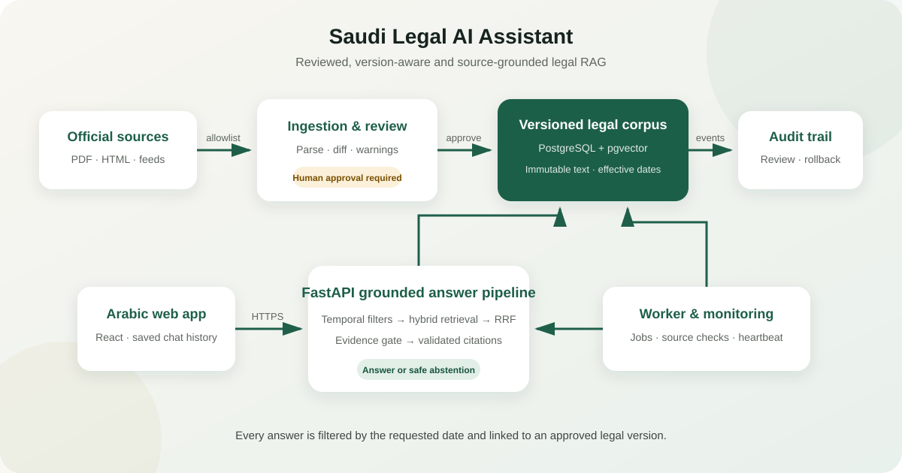
</p>

> **Assessment scope:** this is an engineering MVP and legal-information tool, not legal advice. The production bootstrap and runtime use official sources only. Synthetic fixtures remain isolated to automated tests and are never loaded into the application corpus.

## What is implemented

| Capability | Status |
|---|---|
| Arabic parsing, immutable document versions and effective-date intervals | Implemented |
| PostgreSQL full-text + pgvector retrieval with reciprocal-rank fusion | Implemented |
| Evidence gating, article citations, answer validation and abstention | Implemented |
| **Nightly 00:00 Asia/Riyadh sync** with catch-up, retries, one run per day, advisory lock | Implemented — [autonomous_sync.md](docs/autonomous_sync.md) |
| **Deterministic release gate**: auto-publish new laws, amendments and repeals; quarantine with reason codes | Implemented |
| **Bounded agent** (5 allowlisted tools; rules or OpenAI structured proposals verified against the source) | Implemented |
| Immutable source snapshots, incremental re-embedding, validated index generations with rollback | Implemented |
| Freshness contract in every answer and in the UI (`/api/v1/freshness`) | Implemented |
| Operator dashboard: sync runs, quarantine, generations, rollback; manual review as escape hatch | Implemented |
| Horizontal scaling: stateless API, shared rate limits, proxy-aware client IPs, answer cache | Implemented — [scaling.md](docs/scaling.md) |
| Arabic React UI for chat, corpus, review and operations | Implemented |
| Persistent chat history | Implemented in browser storage; last 50 completed messages, with a clear-chat action |
| Related government-service cards | Implemented by searching the complete official MOJ/Najiz catalog, cached with a reviewed outage fallback; separate from legal citations |
| Authentication, audit events, traces, worker heartbeat and health checks | Implemented |
| Official Umm Al-Qura acquisition and production email delivery | Official acquisition implemented; email delivery remains deployment-specific |

Latest verified release-candidate run (20 October 2026): **200 backend tests passed** (including the PRD v2 scenarios T01–T10, retrieval-relevance regression, scheduler compliance and scaling safeguards), Python and frontend lint passed, Python's 55 installed packages were compatible, the npm production audit found zero known vulnerabilities, and both API and web Docker images built successfully. The separate 34-case test-fixture evaluation measured 100% Recall@5, 100% citation accuracy, 96.2% auto-checked correctness, 100% abstention and 100% temporal scenarios. See the generated [evaluation report](tests/evaluation/results/report.md) for its deliberately synthetic scope.

## System walkthrough

The screenshots below document the implemented Arabic RTL workflow. They are UI test captures; the running corpus is populated independently from official sources and every live citation links to its government page.

### Arabic chat and grounded answers

<table>
  <tr>
    <td width="50%" align="center">
      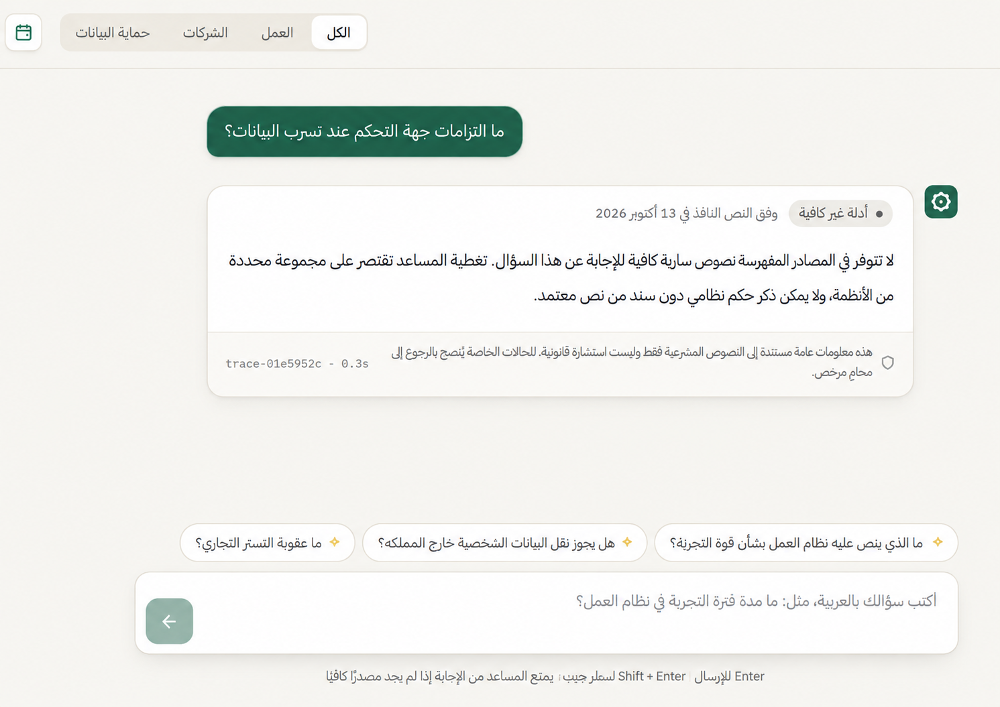<br>
      <sub><b>Safe abstention:</b> the assistant clearly refuses to state a legal rule when the indexed evidence is insufficient.</sub>
    </td>
    <td width="50%" align="center">
      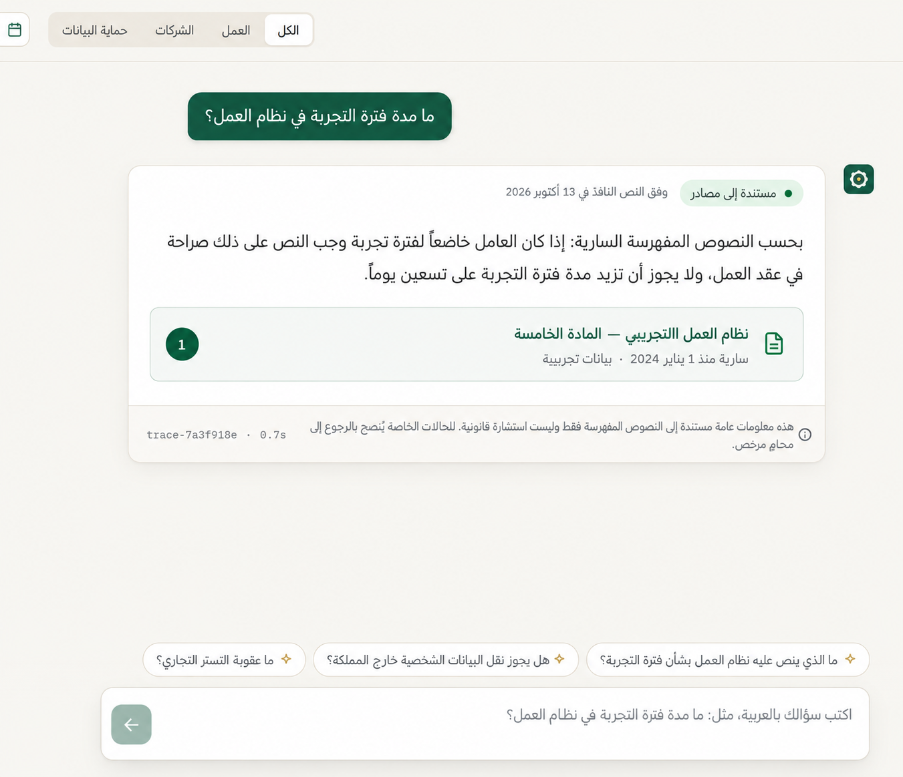<br>
      <sub><b>Grounded answer:</b> an in-corpus question returns the applicable rule, effective-date context and a citation to article 5.</sub>
    </td>
  </tr>
</table>

### Citations and source inspection

<p align="center">
  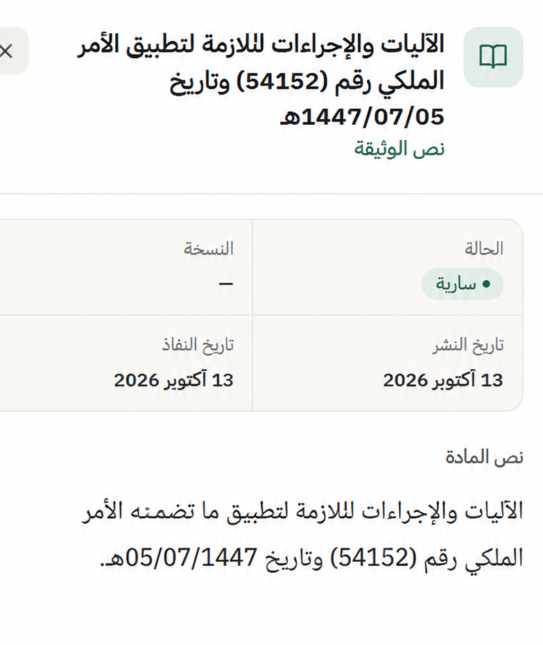
</p>

<p align="center"><sub><b>Citation panel:</b> clean controlling text without copied page navigation or artificial spacing, alongside review status, publication date and effective date.</sub></p>

### Corpus dashboard and immutable versions

<p align="center">
  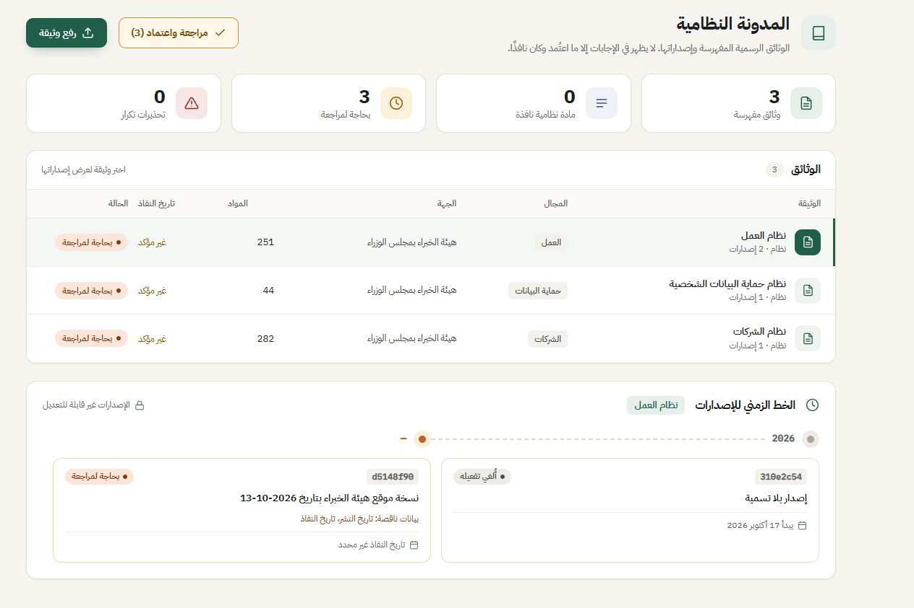
</p>

<p align="center"><sub><b>Corpus dashboard:</b> reviewed documents, pending-review counts, duplicate warnings and immutable version timeline.</sub></p>

<table>
  <tr>
    <td width="50%" align="center">
      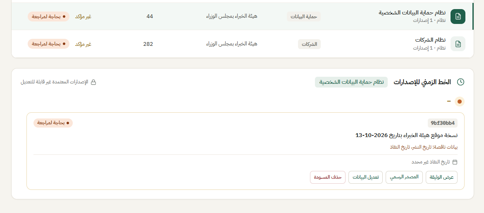<br>
      <sub><b>Version timeline:</b> current and pending versions with their effective-date state.</sub>
    </td>
    <td width="50%" align="center">
      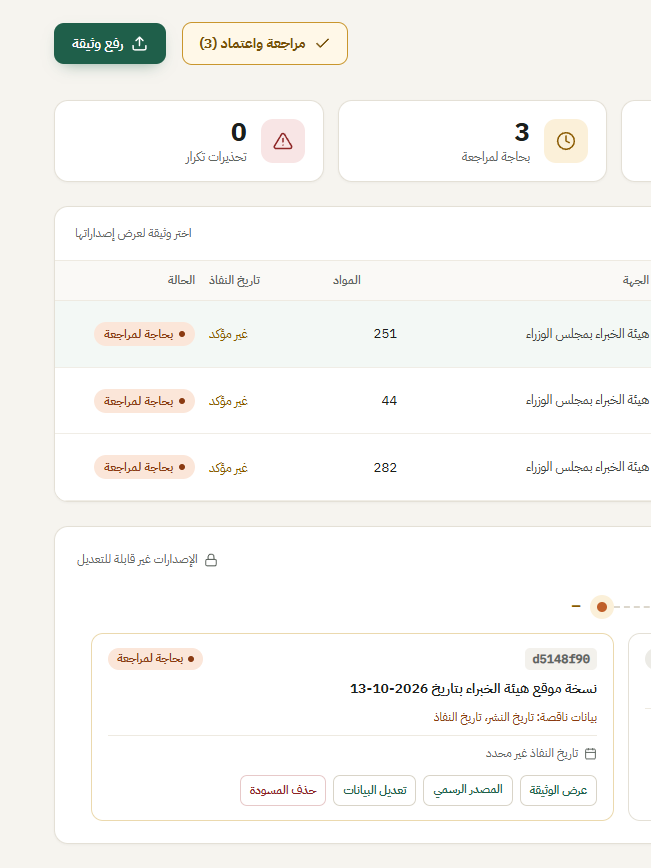<br>
      <sub><b>Reviewer controls:</b> view document, edit metadata, open official source or remove a draft.</sub>
    </td>
  </tr>
</table>

### Document review and official-source verification

<p align="center">
  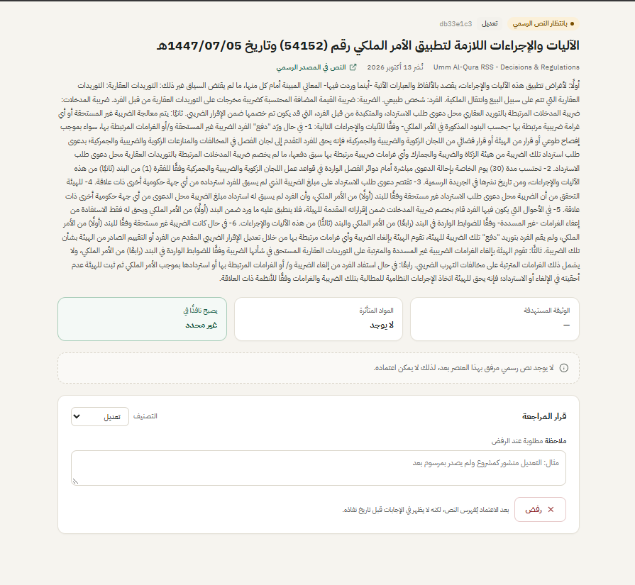
</p>

<p align="center"><sub><b>Document review:</b> extracted Arabic text, source identity, content classification, affected instrument and temporal metadata.</sub></p>

<table>
  <tr>
    <td width="50%" align="center">
      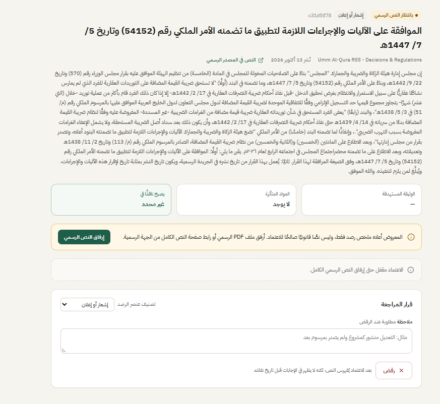<br>
      <sub><b>Source gate:</b> an observed publication cannot be approved until its complete official text is attached.</sub>
    </td>
    <td width="50%" align="center">
      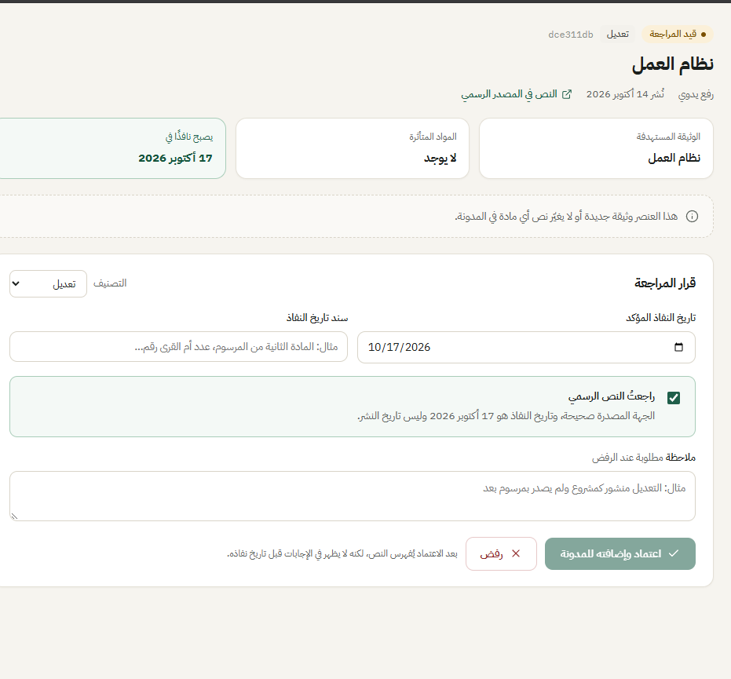<br>
      <sub><b>Review decision:</b> classification, effective-date evidence, source confirmation, approval and rejection.</sub>
    </td>
  </tr>
</table>

### Approval, publication and effective-date controls

<p align="center">
  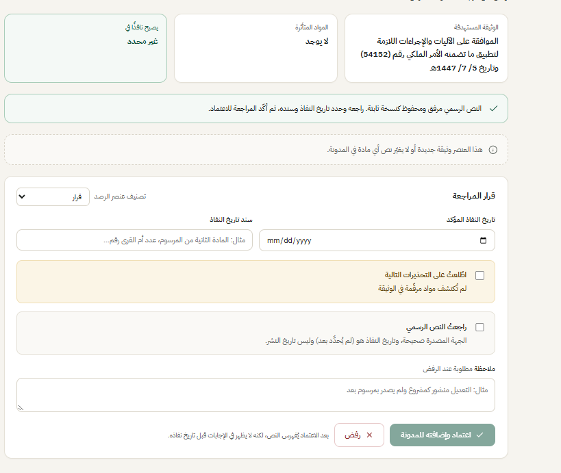
</p>

<p align="center"><sub><b>Approval safeguards:</b> publication date and effective date remain separate; reviewer confirmations are required before indexing.</sub></p>

<table>
  <tr>
    <td width="50%" align="center">
      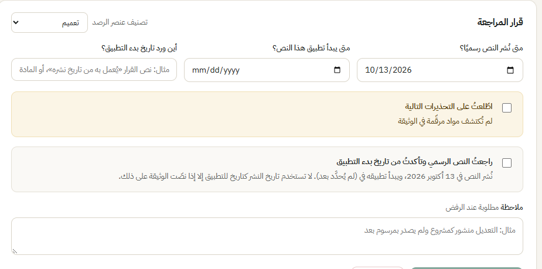<br>
      <sub><b>Temporal review:</b> explicit publication date, effective date and the legal evidence establishing applicability.</sub>
    </td>
    <td width="50%" align="center">
      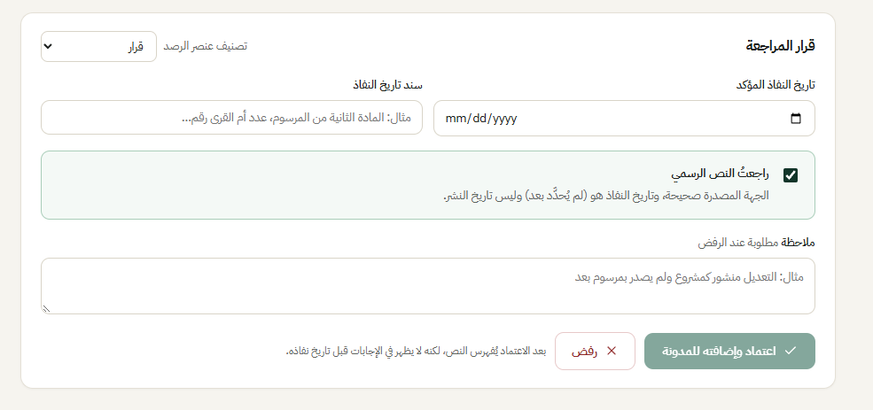<br>
      <sub><b>Final confirmation:</b> the reviewer confirms the controlling text before adding it to the corpus.</sub>
    </td>
  </tr>
</table>

### Approved state

<p align="center">
  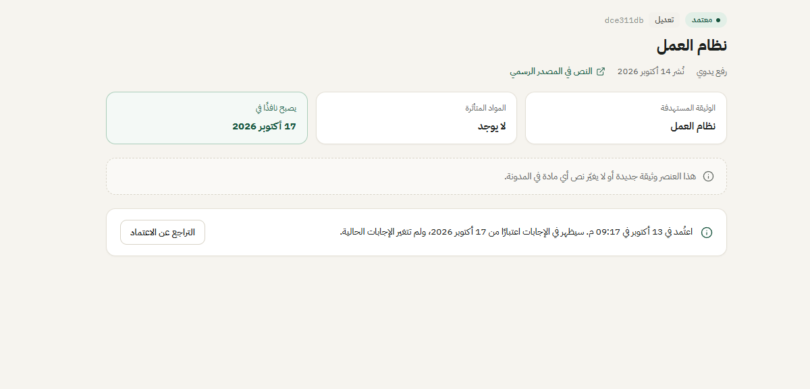
</p>

<p align="center"><sub><b>Approved version:</b> immutable review outcome, activation date and audit information after publication to the corpus.</sub></p>

## Five-minute evaluator setup

Requirements: Docker Desktop with Compose. The default runtime uses official sources only.

### Windows PowerShell

```powershell
Copy-Item .env.example .env
# Set ADMIN_PASSWORD to 12+ characters in .env
docker compose up --build -d
docker compose run --rm migrate python -m legal_core.cli bootstrap
cd apps/web
npm install
npm run dev
```

### macOS / Linux

```bash
cp .env.example .env
# Set ADMIN_PASSWORD to 12+ characters in .env
docker compose up --build -d
docker compose run --rm migrate python -m legal_core.cli bootstrap
cd apps/web
npm install
npm run dev
```

Open:

- Web app: <http://localhost:5173/#app>
- Reviewer login: <http://localhost:5173/#login>
- API documentation: <http://localhost:8000/docs>
- Readiness probe: <http://localhost:8000/health/ready>

Use `ADMIN_EMAIL` and `ADMIN_PASSWORD` from `.env` for the reviewer account. If port `5432` is occupied, set both `POSTGRES_PORT` and the port in `DATABASE_URL`.

## Suggested evaluation flow

1. Sign in as the reviewer and open **Operations**; confirm the official Umm Al-Qura source is enabled.
2. Press **تشغيل المزامنة الآن** (the same pipeline that runs at 00:00 Riyadh).
3. The run summary shows discovered, published and quarantined official items. Open every citation at
   its original government page.
4. Ask a question covered by a published item and confirm the answer cites that official version.
5. Ask an out-of-corpus question and confirm the assistant abstains without inventing citations.
6. Refresh the browser: the completed conversation remains available. The freshness bar shows the
   last verified synchronization and source health.

The full scenario list (T01–T10) is automated in [`tests/integration/test_nightly_sync.py`](tests/integration/test_nightly_sync.py); see [docs/autonomous_sync.md](docs/autonomous_sync.md) for the demo script and traceability.

## How the RAG pipeline works

1. The query date and optional legal domain filter the corpus to **approved** versions effective on that date.
2. PostgreSQL Arabic lexical search and pgvector semantic search produce separate rankings.
3. Reciprocal-rank fusion combines the rankings; statute and article hints add deterministic signals.
4. An evidence gate rejects weak retrieval before any language model is called.
5. The answer provider receives only retrieved evidence identifiers and text.
6. The server validates citations and constructs source metadata from database rows, never from model output.
7. Invalid output is retried once, then replaced by a cited extractive fallback.

After the legal pipeline, a separate deterministic matcher may attach a relevant Ministry of Justice/Najiz
service card for action-oriented questions. The API synchronizes the Ministry's public SharePoint service
catalog at startup and every hour, then searches Arabic service titles and descriptions. The working snapshot
exists only in process memory (not as a manually maintained database); the last good snapshot survives a temporary
source outage until the process restarts, and a small reviewed set covers a cold-start outage.
Service cards use an exact HTTPS host allowlist and carry `legal_evidence: false`; they remain available when
the legal answer abstains, and are never inserted into the legal evidence or citation set.

The default `hash` embedding and `extractive` answer providers are deterministic test/local fallbacks and only measure surface overlap. Production refuses those fallbacks: set `EMBEDDING_PROVIDER=openai`, `LLM_PROVIDER=openai`, and `OPENAI_API_KEY` for semantic Arabic retrieval and grounded contextual answers. After changing an embedding provider, model or dimension, run `python -m legal_core.cli reindex-approved`; the old index remains active if embedding or validation fails.

## Autonomous update lifecycle

```text
00:00 Asia/Riyadh → discover (official feeds) → fetch + immutable snapshot → dedupe → parse
                  → classify (bounded agent) → deterministic release gate
                       ├─ pass → version + incremental embeddings → health-checked generation switch
                       ├─ uncertain → quarantine (reason code, alert, retried when transient)
                       └─ draft / notice / news → excluded
                  → audit + freshness report → date-aware RAG
```

A change is published only when every code-level check passes: official source, stored snapshot, supported legal type, valid article structure, resolved target instrument, exactly one effective date read from a commencement clause, and no conflicting version. Publication date is never silently used as the effective date. Failures leave the active corpus intact; rollback restores an earlier index generation without deleting history. An operator can still approve or reject a quarantined item (escape hatch), but routine updates need zero clicks.

## Local development

Requires Python 3.11 or 3.12, [uv](https://docs.astral.sh/uv/) and PostgreSQL with pgvector 0.8+ (`docker compose up -d db` provides the database).

```bash
uv sync
uv run alembic upgrade head
uv run python -m legal_core.cli bootstrap
uv run uvicorn api.main:app --reload
uv run python -m worker.main
```

In another terminal:

```bash
cd apps/web
npm install
npm run dev
```

`VITE_API_URL` defaults to `http://localhost:8000`. If it changes, add the frontend origin to `CORS_ORIGINS`.

## Verification

Backend quality and test suite:

```bash
uv run ruff check .
uv run pytest -q
```

Frontend quality and production build:

```bash
cd apps/web
npm run lint
npm run build
```

Evaluation harness:

```bash
uv run python -m tests.evaluation.run_eval
# Uses providers configured in .env:
uv run python -m tests.evaluation.run_eval --live
```

Integration tests need a PostgreSQL database whose name ends in `_test`, or an explicit `TEST_DATABASE_URL`. The harness rebuilds only that test database. The latest fixture-corpus report is in [`tests/evaluation/results/report.md`](tests/evaluation/results/report.md); it is a regression result, not a claim about performance on all Saudi legislation.

The PRD demonstration cases are covered as follows:

| Case | Automated verification |
|---|---|
| Cited answer | `test_q1_answer_carries_an_article_level_citation_and_trace` |
| Out-of-corpus abstention | `test_q2_out_of_corpus_question_abstains_without_citations` |
| Different answers by date | `test_q6_q3_approval_changes_time_valid_answers_and_is_audited` |
| Idempotent feed reads | `test_q4_repeated_feed_reads_create_exactly_one_candidate` |
| Unapproved update is invisible | `test_q5_unapproved_update_never_reaches_answers` |
| Approval indexes and audits | `test_q6_q3_approval_changes_time_valid_answers_and_is_audited` |
| Hostile document instructions | `test_q7_instructions_inside_documents_are_not_followed` |
| Source outage | `test_q8_source_outage_is_retried_reported_and_harmless` |

PRD v2 scenarios T01–T10, scheduler compliance, rollback and fault injection are mapped test-by-test in
[docs/autonomous_sync.md](docs/autonomous_sync.md#prd-traceability).

## Privacy and security defaults

- Question text is not stored server-side unless `TRACE_STORE_QUERY_TEXT=true`; traces retain a query hash and retrieved/cited identifiers.
- Browser chat history is local to that browser profile, capped at 50 completed messages and removable from the chat header.
- Source fetching is restricted by `SOURCE_ALLOWLIST`; redirects are checked again.
- Uploaded HTML has active content removed. Instruction-like legal passages are quarantined from evidence and require reviewer acknowledgement.
- Admin endpoints require JWT authentication; secrets belong in `.env`, which is ignored by Git.
- Rate limits, upload size/type validation, audit logging and worker-readiness checks are enabled.

See [`docs/source_policy.md`](docs/source_policy.md) for source governance and [`docs/architecture.md`](docs/architecture.md) for data invariants and retrieval details.

## Configuration

See [`.env.example`](.env.example). Important variables:

| Variable | Purpose |
|---|---|
| `LLM_PROVIDER`, `LLM_MODEL` | `extractive` for offline reproducibility or `openai` for grounded generation |
| `EMBEDDING_PROVIDER`, `EMBEDDING_MODEL`, `EMBEDDING_DIM` | `hash` or `openai`; model changes require re-indexing |
| `SOURCE_ALLOWLIST` | Hosts allowed for monitored acquisition |
| `ALLOW_FIXTURE_SOURCES` | Must remain `false` outside automated tests |
| `TRACE_STORE_QUERY_TEXT`, `TRACE_RETENTION_DAYS` | Trace privacy and retention |
| `MIN_LEXICAL_COVERAGE`, `MIN_VECTOR_SIMILARITY` | Retrieval evidence thresholds |
| `SYNC_TIMEZONE`, `SYNC_CATCHUP_DAYS`, `SYNC_MAX_RETRIES`, `AGENT_PROVIDER`, `ALERT_WEBHOOK_URL` | Nightly synchronization |
| `WEB_CONCURRENCY`, `DB_POOL_SIZE`, `DB_MAX_OVERFLOW`, `TRUSTED_PROXY_COUNT`, `RATE_LIMIT_BACKEND`, `ANSWER_CACHE_SIZE` | Scaling — see [docs/scaling.md](docs/scaling.md) |

## Repository layout

```text
apps/web/              React + TypeScript Arabic UI
packages/legal_core/   Parsing, ingestion, temporal rules, retrieval and answer pipeline
services/api/          FastAPI routes, schemas and authentication
services/worker/       PostgreSQL job runner, scheduler and heartbeat
db/migrations/         Alembic schema migrations
fixtures/              Automated-test inputs only; never loaded by bootstrap or production
tests/                 Unit, integration, security workflows and evaluation harness
docs/                  Architecture, source policy and API notes
```

## Railway live demo

The recommended Railway layout runs a pgvector database, a stateless API with
2+ replicas, exactly one worker (nightly sync + job queue) and the React
frontend. Documents are stored as database snapshots, so no volume is needed.
The default deterministic providers require no OpenAI key; legal content still comes from the official source.

Follow the service settings, variables (including `TRUSTED_PROXY_COUNT=1`
behind Railway's proxy), migration command, health check and smoke test in
[the Railway deployment guide](deploy/railway/README.md); Kubernetes manifests
are in [`deploy/k8s`](deploy/k8s). Keep the evaluator's administrator
credentials private rather than publishing them in this README.

## Known limitations

- Coverage starts with the official Umm Al-Qura decisions-and-regulations feed and grows through nightly synchronization; this MVP does not claim complete coverage of all Saudi law.
- The deterministic hash embedding provider is useful for repeatability, not semantic-quality claims. A real embedding model is needed for paraphrases with little shared vocabulary.
- OpenAI generation is implemented but requires the evaluator's own API key and a live evaluation run.
- Scanned PDFs requiring OCR are rejected with a clear error and are outside this MVP.
- Amendments containing only changed clauses are quarantined (`AMBIGUOUS_AMENDMENT_MAPPING`) rather than automatically merged into a consolidated law.
- Hijri-only commencement dates are quarantined (`HIJRI_DATE_UNVERIFIED`); no Umm al-Qura calendar conversion is bundled.
- The Umm Al-Qura decisions-and-regulations feed is enabled with same-host `fetch_allowed`; every fetched page still passes allowlist, SSRF, MIME, size and deterministic release-gate checks.
- Supplementary web search is an extension point (`SearchProvider`); no search API is bundled.
- The answer cache is per process; a shared cache (e.g. Redis) would raise hit rates across replicas.
- Password-reset email delivery and production TLS termination are deployment responsibilities.
- A PDPL/cross-border data-transfer assessment is required before handling real user questions in production.

## Further documentation

- [Architecture and invariants](docs/architecture.md)
- [Autonomous nightly synchronization (PRD v2)](docs/autonomous_sync.md)
- [Scaling and stability for 1,000+ users](docs/scaling.md)
- [Source governance](docs/source_policy.md)
- [Frontend/API integration](docs/api.md)
- [Evaluation report](tests/evaluation/results/report.md)
